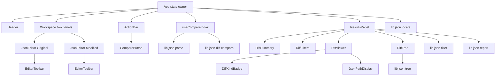
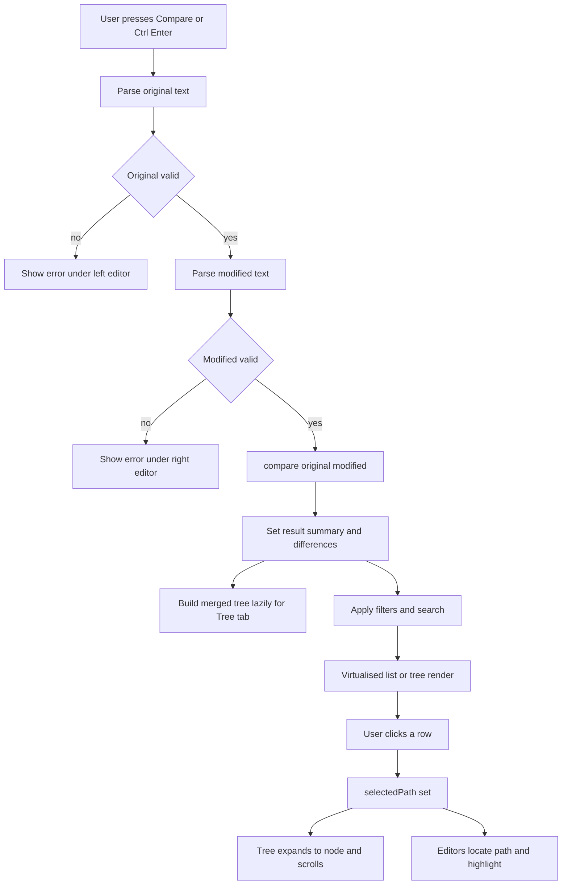
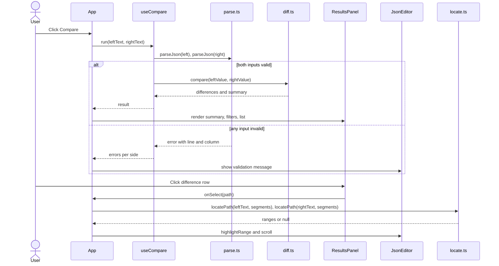

# Architecture: JSON Diff

## Complexity and task plan

**Rating: medium.** There is no backend and no external integration. But there are about 40 source files. There is a pure algorithmic core (diff, JSONPath, error positions, path-to-offset locator) that needs thorough tests. There is a Vite build, a UI kit (shadcn/ui), a code-editor component, and virtualised rendering for large documents.

**Task-count guidance: 12–18 tasks.** The Task Creation stage picks the exact number. A natural order is:

1. Scaffold (Vite, Tailwind, shadcn, Vitest, lint, CSP).
2. Types, path formatting, and parse with line/column errors.
3. Diff engine and its tests.
4. Merged tree model, filter, report and locator modules, with tests.
5. Theme, preferences and persistence hooks.
6. Editor, toolbar, and upload/format/minify/copy.
7. Compare flow and shortcuts.
8. Summary and filters.
9. Virtualised diff viewer.
10. Tree view.
11. Click navigation into the tree and editors.
12. Report download.
13. Responsive layout, accessibility and polish.
14. README with known limitations.
15. Coverage and large-fixture tests.

## Assumptions

- Interpretations from the vision are kept: counts are disjoint, and total = added + removed + modified + typeChanged.
- Container type changes are reported once, at their own path.
- A whole added or removed subtree is reported once, at its root path, not per child.
- Null versus a missing key is added or removed.
- `-0` equals `0`.
- Number precision, `1.0` versus `1`, and duplicate keys (last wins) are known limitations, documented in the README and in a small "Limitations" popover in the UI.
- Arrays are compared by index. A persistent note in the results header says so.
- Version numbers below were checked via web search in Nov 2026. `package-lock.json` is the source of truth after install.

## Stack

| Concern | Choice | Version (checked) | Why |
|---|---|---|---|
| Runtime / package manager | Node + npm | Node >= 22.12 (required by Vitest 5) | Boring and universal. |
| Language | TypeScript, strict | whatever `create-vite` scaffolds (6.x). TS 7 exists but is not assumed to be supported by the lint toolchain. | Type-safe `JsonValue` and `Difference` unions. |
| UI | React | ^19.3 | Required by the brief. |
| Build / dev server | Vite + `@vitejs/plugin-react` | vite ^8.3, plugin-react ^6.3 | Required by the brief. |
| Styling | Tailwind CSS v4 via `@tailwindcss/vite` | ^4.3 | No config file. Theme tokens live in CSS variables in `index.css`. |
| Components | shadcn/ui (copied into `src/components/ui`) | CLI `npx shadcn@latest` | Required by the brief. Use `button`, `badge`, `input`, `toggle-group`, `tooltip`, `dropdown-menu`, `switch`, `select`, `popover`. |
| Icons | `lucide-react` | ^1.72 | Required by the brief. |
| Editor | CodeMirror 6 via `@uiw/react-codemirror` + `@codemirror/lang-json` + `@codemirror/view`/`state` | react-codemirror ^4.25, view ^6.43 | See decision D1. |
| List virtualisation | `@tanstack/react-virtual` | ^3.14 | Headless. Used by the diff list and the tree. |
| Diff engine | Custom recursive comparison, no library | n/a | See D2. |
| Tests | Vitest + `@vitest/coverage-v8`, jsdom, `@testing-library/react` | vitest ^5.1 | Required by the brief. Vitest 5 needs Vite >= 6.4 and Node >= 22.12. |
| Lint | ESLint + typescript-eslint (create-vite template) | scaffold default | Already in the template. |

Not used: a router (single screen), a global state library, a backend, any analytics, any CDN script or font.

## Key decisions

**D1. CodeMirror 6 for the editors, not Monaco or a textarea overlay.**
- It renders only the visible viewport, so highlighting a multi-MB document stays fast. A `<pre>` overlay would highlight all of it.
- It gives line numbers, JSON highlighting, line decorations, and `scrollIntoView` for click-to-navigate.
- It is far lighter than Monaco, and Monaco's diff is text-level, which we explicitly do not want.
- Theme switching uses a CodeMirror theme extension tied to the app theme (`oneDark` or a small custom dark theme, plus a light one).
- `Mod-Enter`, `Mod-Shift-f` and `Mod-Shift-x` are registered as editor keymap entries (with `preventDefault`) as well as on `window`. CodeMirror would otherwise swallow them.

**D2. Custom diff, not a library.**
- Libraries emit JSON Patch or apply array heuristics. We need by-index arrays, the four-kind classification, container-level type-change rules, and our own JSONPath format.
- The algorithm is about 100 lines and linear.
- It needs only `JsonValue` and no DOM, so it is trivially testable.

**D3. Diff and parse run on the main thread, with explicit deferral, not a Web Worker.**
- `JSON.parse` and a linear diff over a few MB take tens to low hundreds of ms.
- Rendering is the real bottleneck, and that is solved by virtualisation and "collapsed by default" trees.
- On Compare the UI sets `pending`, yields one frame (`setTimeout 0`), computes, then renders. The loading indicator is shown only if the work exceeds about 150 ms.
- Revisit a Worker only if profiling shows jank. The diff function is pure, so moving it later costs little.

**D4. Path to editor position by a small scanner (`locate.ts`), not a position-aware parser library.**
- It tokenises the JSON text once and records `path -> [from, to]` offsets for values.
- The offsets are only built lazily when the user clicks a difference. This keeps Compare fast.
- If the path is absent (the removed side has no node for an added path), it falls back to the nearest existing ancestor.
- It shares `path.ts` with the diff, so path strings always match.
- Parse-error line/column come from `parse.ts`. It reads the position out of the `JSON.parse` error message where present (V8 gives `position N` or `line L column C`). It falls back to a tiny own scanner to find the failing offset, so errors are consistent across browsers.

**D5. Virtualised flat rows for both result views.**
- The diff list is already flat. The tree is flattened by a pure function `flattenTree(root, expanded, {changedOnly})` into rows `{id, depth, node}`. Both render through `useVirtualizer`.
- The tree exposes ARIA: `role="tree"`, `treeitem`, `aria-expanded`, `aria-level`, and arrow-key navigation.
- Default expansion is depth 1. Expand all on a huge document is allowed, because rows are virtualised. The expand-all cost is a `Set` of ids, so it is O(nodes).

**D6. State is plain React state in `App` plus small hooks.**
- `leftText`, `rightText`, `result`, `filters`, `selectedPath`, `prefs`.
- Preferences (theme, indent, auto-compare, view mode, save-drafts flag) go through `useLocalStorage`.
- Drafts are saved only if the user has opted in. See Security.
- There is no Redux or context beyond a theme class on `<html>`.

**D7. Compare trigger.**
- The Compare button, `Mod+Enter`, and (optionally) an "Auto-compare" switch. When on, a change to either editor triggers a recompute after a 500 ms debounce.
- Live validation per editor is debounced at 300 ms. Auto-compare is off by default, because comparison is explicit in the brief.

**D8. Error handling.**
- `parseJson(text)` returns `{ok: true, value} | {ok: false, error: {message, line, column}}` and never throws. Empty or whitespace-only input is its own case.
- `compare()` never throws on valid values. Pathological depth is caught at the call site and shown as an error banner.
- A React error boundary wraps the results area.

## Patterns chosen and rejected

| Pattern | Decision | Reason |
|---|---|---|
| Pure function core (functional core, imperative shell) | Chosen | The `lib/json/*` modules have no React or DOM. All the correctness risk lives there and is unit-tested. |
| Result type (`ok`/`error` union) for parsing | Chosen | Invalid input is expected, not exceptional. |
| Discriminated union for `Difference` | Chosen | Makes the four kinds, and which fields exist, exhaustive in the type checker. |
| Custom hooks (`useTheme`, `useLocalStorage`, `useDebouncedValue`, `useCompare`, `useShortcuts`) | Chosen | One reason to change each. |
| Presentational components with props only | Chosen | Components receive data and callbacks. Only `App` owns state. |
| Strategy / plugin for array matching | **Rejected** | Only by-index is in scope. Add it when a second strategy is actually requested. |
| Repository / storage abstraction | **Rejected** | One `localStorage` wrapper hook is enough. |
| Redux / Zustand / Context for app state | **Rejected** | One screen, shallow tree. Props are fine. |
| Web Worker | **Rejected for now** | See D3. |
| Diff library (jsondiffpatch, deep-diff) | **Rejected** | See D2. |
| Monaco editor | **Rejected** | Heavy, text-level diff. |
| Abstract factory or generic "diff provider" | **Rejected** | No variation shown in the vision. |

## File structure

```
.
├── AGENTS.md
├── README.md                      (limitations, shortcuts, privacy note)
├── index.html                     (CSP meta, loads /theme-init.js)
├── package.json
├── vite.config.ts                 (react, tailwind, "@" alias, vitest config)
├── tsconfig.json / tsconfig.app.json / tsconfig.node.json
├── components.json                (shadcn)
├── eslint.config.js
├── public/
│   └── theme-init.js              (sets html.dark before paint; external, so CSP stays strict)
├── atlas/                         (vision, research, architecture, constraints)
└── src/
    ├── main.tsx
    ├── App.tsx                    (owns state, wires everything)
    ├── index.css                  (Tailwind import, CSS variables for light/dark, diff colours)
    ├── lib/
    │   ├── utils.ts               (shadcn `cn`)
    │   └── json/
    │       ├── types.ts           (JsonValue, JsonType, Difference, DiffResult, DiffSummary)
    │       ├── jsonType.ts        (getJsonType(v))
    │       ├── path.ts            (appendKey, appendIndex, formatPath(segments))
    │       ├── diff.ts            (compare(original, modified): DiffResult)
    │       ├── parse.ts           (parseJson, formatJson, minifyJson, error line/column)
    │       ├── locate.ts          (locatePath(text, path): {from,to} | null)
    │       ├── tree.ts            (buildMergedTree, flattenTree)
    │       ├── filter.ts          (filterDifferences(diffs, {kinds, query}))
    │       ├── display.ts         (previewValue(v, maxLen) for rows)
    │       ├── report.ts          (buildReport, reportFileName)
    │       ├── sample.ts          (sample original/modified)
    │       └── *.test.ts          (colocated Vitest tests)
    ├── hooks/
    │   ├── useLocalStorage.ts
    │   ├── useTheme.ts
    │   ├── useDebouncedValue.ts
    │   ├── useCompare.ts          (parse both, call compare, pending/error state)
    │   └── useShortcuts.ts
    ├── components/
    │   ├── Header.tsx             (logo, tagline, privacy badge, theme toggle)
    │   ├── JsonEditor.tsx         (CodeMirror wrapper; props: value, onChange, error, highlightRange)
    │   ├── EditorToolbar.tsx      (copy, clear, format, minify, upload, indent select)
    │   ├── CompareButton.tsx
    │   ├── ActionBar.tsx          (swap, clear both, format both, auto-compare, drafts opt-in)
    │   ├── ValidationMessage.tsx  (error with line/column, or empty hint)
    │   ├── DiffSummary.tsx        (cards: total, added, removed, modified, type changes)
    │   ├── DiffFilters.tsx        (kind toggle-group + search box)
    │   ├── DiffViewer.tsx         (virtualised side-by-side rows)
    │   ├── DiffTree.tsx           (virtualised ARIA tree + expand/collapse/changed-only)
    │   ├── DiffKindBadge.tsx      (icon + label + colour, single source of kind styling)
    │   ├── JsonPathDisplay.tsx    (monospace path with copy-on-click)
    │   ├── ResultsPanel.tsx       (tabs: List / Tree, array-by-index note, download report)
    │   ├── ErrorBoundary.tsx
    │   └── ui/                    (shadcn generated)
    └── test/
        ├── setup.ts               (jest-dom, matchers)
        └── fixtures.ts            (generateLargeDoc(n), pair generators)
```

## Component flowchart



## High-level design

| Component | Responsibility | Talks to |
|---|---|---|
| `lib/json/*` (core) | Pure logic: parse, diff, path, tree, filter, report, locate. No React. | Imported by hooks and components only. |
| `App` | Owns `leftText`, `rightText`, `prefs`, `result`, `filters`, `selectedPath`. Handles shortcuts. | Hooks and every component through props. |
| `useCompare` | Parses both texts, calls `compare`, tracks `pending` and `error`. Delays the loading flag by about 150 ms. | `parse.ts`, `diff.ts`. |
| `JsonEditor` | CodeMirror instance. Reports changes. Scrolls to and highlights a range on request. | `locate.ts` (through the `highlightRange` prop). |
| `ResultsPanel` | Holds the view tab, filters and download action. Applies `filterDifferences`. | Summary, filters, viewer, tree, `report.ts`. |
| `DiffViewer` / `DiffTree` | Virtualised rendering. Emit `onSelect(path)`. | `DiffKindBadge`, `JsonPathDisplay`. |

Boundaries: only `parse.ts` calls `JSON.parse`. Only `path.ts` builds path strings. Only `DiffKindBadge` maps a kind to a colour, icon and label. Only `report.ts` defines the report schema. Each fact has one home.

## Low-level design

### Data models (`lib/json/types.ts`)

The types below are described, not coded here. The exact declarations are written in `types.ts` during implementation.

| Type | Shape | Notes |
|---|---|---|
| `JsonPrimitive` | string, number, boolean or null | |
| `JsonValue` | a `JsonPrimitive`, an array of `JsonValue`, or an object mapping string keys to `JsonValue` | Recursive union. |
| `JsonType` | one of `object`, `array`, `string`, `number`, `boolean`, `null` | Result of `getJsonType`. Distinguishes arrays and null from objects. |
| `DiffKind` | one of `added`, `removed`, `modified`, `type-changed` | Drives colour, icon, label, and the summary counters. |
| `PathSegment` | a string (object key) or a number (array index) | |
| `Difference` | `kind`, `path`, `segments`, plus optional `original`, `modified`, `originalType`, `modifiedType` | `path` is the JSONPath string, for example `$.user.items[2]['a.b']`. `segments` is the same location as a `PathSegment` list. `original` and `originalType` are absent for `added`. `modified` and `modifiedType` are absent for `removed`. |
| `DiffSummary` | numeric counters `total`, `added`, `removed`, `modified`, `typeChanged` | `total` equals the sum of the other four. |
| `DiffResult` | `differences` (a list of `Difference`) and `summary` (a `DiffSummary`) | Return type of `compare`. |

"Absent" is represented by the property being omitted (not `undefined`-assigned and not `null`), so it can't be confused with a JSON `null`. The report keeps the same rule.

### Diff algorithm (`diff.ts`)

`compare(a, b): DiffResult` walks both values with `walk(a, b, segments)`:

1. Compute `ta = getJsonType(a)` and `tb = getJsonType(b)`. `getJsonType` checks `null` and `Array.isArray` first.
2. If `ta !== tb`, emit one `type-changed` and return. No children are listed.
3. If both are primitives: emit `modified` if `a !== b`.
4. If both are arrays: for `i < min(len)`, recurse. For `i >= len(a)`, emit `added` at `[i]`. For `i >= len(b)`, emit `removed` at `[i]`.
5. If both are objects:
   - Iterate `Object.keys(a)` in order. If the key is not an own property of `b`, emit `removed`. Otherwise recurse.
   - Then iterate the keys of `b` that are not own properties of `a`, emitting `added`.
   - Use `Object.prototype.hasOwnProperty.call`. Never index with a key onto a plain object that is written to. `__proto__` is safe, because `JSON.parse` creates it as an own key and we only read.
6. The summary is computed by counting `kind`. Output order is deterministic: document order, with added keys after the original's keys at each level.

Depth: recursion is fine for realistic depth. `JSON.parse` itself can fail on extreme nesting. `useCompare` wraps `compare` in try/catch and reports a `RangeError` as "Document is too deeply nested to compare".

### Path format (`path.ts`)

- The root is `$`.
- A key matching `/^[A-Za-z_$][A-Za-z0-9_$]*$/` is written `.key`.
- Any other key is written `['…']` with `\` and `'` escaped.
- An index is `[n]`.
- `formatPath(segments)` is the single formatter. The locator and tree use segment arrays and derive strings through it.

### Parse and format (`parse.ts`)

- `parseJson(text): ParseResult`: empty or whitespace gives `{ok:false, error:{kind:'empty'}}`. A syntax error gives `{kind:'syntax', message, line, column}`.
- `formatJson(value, indent: 2 | 4 | 'tab')`, `minifyJson(value)`.
- Format and minify operate on parsed values. If the input is invalid, they leave the text untouched and surface the validation error.

### Locator (`locate.ts`)

`locatePath(text, segments): {from: number; to: number} | null`. It makes a single pass over the text with a small recursive-descent scanner that tracks the segments. It stops early when the target is reached, and returns the nearest ancestor range if the target does not exist.

### Tree (`tree.ts`)

- `buildMergedTree(original, modified, differences)` builds a `TreeNode {id, key, segments, type, kind?, original?, modified?, children?}`. It uses the union of keys, and for arrays the max length.
- Nodes touched by a difference carry its `kind`. Ancestors carry `hasChanges`, computed by a map from path to difference and a post-order pass.
- Only container nodes have children. Differences that are a whole subtree (added, removed, type-changed container) mark that node, and its children are drawn from the existing side.
- `flattenTree(root, expandedIds, {changedOnly}): TreeRow[]`.

### Filter (`filter.ts`)

`filterDifferences(diffs, {kinds: Set<DiffKind>, query: string})`. It does a case-insensitive substring match against the property name (last segment), the path, and the stringified original and modified values (truncated for matching to a sane limit). An empty `kinds` set means "all". A cheap pass over a few thousand differences needs no debounce. `useDeferredValue` keeps typing smooth for very large lists.

### Report (`report.ts`)

```json
{
  "tool": "JSON Diff",
  "generatedAt": "ISO-8601",
  "arrayComparison": "by-index",
  "summary": { "total": 3, "added": 1, "removed": 0, "modified": 1, "typeChanged": 1 },
  "differences": [
    { "type": "modified", "path": "$.user.age", "original": 25, "modified": 26 }
  ]
}
```

`original` and `modified` are omitted when absent. The `type` values are `added | removed | modified | type-changed`. The report contains all differences, not just the filtered view. `downloadJson` uses `Blob` and an object URL, revoked right after the click. The user's data stays local.

## Control flow



Both editors are validated, so both errors are shown at once. The flowchart only shows the sequential path for brevity.

## Main interaction



## Security and privacy

- **Local only.** There are no `fetch`, `XMLHttpRequest`, or WebSocket calls anywhere in `src`. `index.html` carries a CSP meta tag: `default-src 'self'; script-src 'self'; style-src 'self' 'unsafe-inline'; img-src 'self' data:; connect-src 'none'; object-src 'none'; base-uri 'none'`. Inline styles are needed by CodeMirror. Fonts are the system monospace stack, with nothing loaded from a CDN. The only network traffic is loading the app's own assets.
- **Untrusted input.** Pasted and uploaded JSON is treated as hostile. The app never uses `dangerouslySetInnerHTML`, `eval`, or `new Function`. Values are rendered as React text. Previews are truncated. The diff avoids prototype-pollution patterns (see the algorithm).
- **Uploads.** Accept `.json` and `application/json`. Cap at 20 MB, with a clear error above it. Read with `File.text()`. Large input is validated before it goes into the editor.
- **Drafts.** Off by default. An explicit switch with the label "Save drafts in this browser (stored unencrypted)" enables it. Drafts over 1 MB are not saved, and storage errors are caught. Turning the switch off deletes the stored drafts. Preferences hold no JSON.
- **No secrets, no auth, no accounts.** No `.env` is needed.
- **Dependencies.** Run `npm audit` before release and keep the lockfile committed.

## UX and accessibility notes

- **Responsive layout.** At `lg` and above, the editors sit side by side with the same height. Below `lg` they stack. The workspace and the results share the viewport on desktop, with results scrolling below the workspace, not in a squeezed pane. The Compare button sits in the action bar between the editors and results, and a compact copy sits in the header on desktop.
- **Kinds shown three ways.** `DiffKindBadge` renders icon, text label and colour.
  - added: `Plus`, green
  - removed: `Minus`, red
  - modified: `Pencil`, amber
  - type-changed: `Replace` (or `ArrowRightLeft`), purple
- Colour tokens are CSS variables, with a separate set per theme, chosen for AA contrast on both backgrounds.
- **Dark by default.** `public/theme-init.js` applies the stored choice, or dark, before first paint.
- **Shortcuts.** A shortcut hint appears as a tooltip on each button. A "Keyboard shortcuts" popover lists all three.
- **Empty and error states.** Empty editors show a placeholder. Empty compare gives a neutral message. Identical documents show a "No differences" confirmation state.
